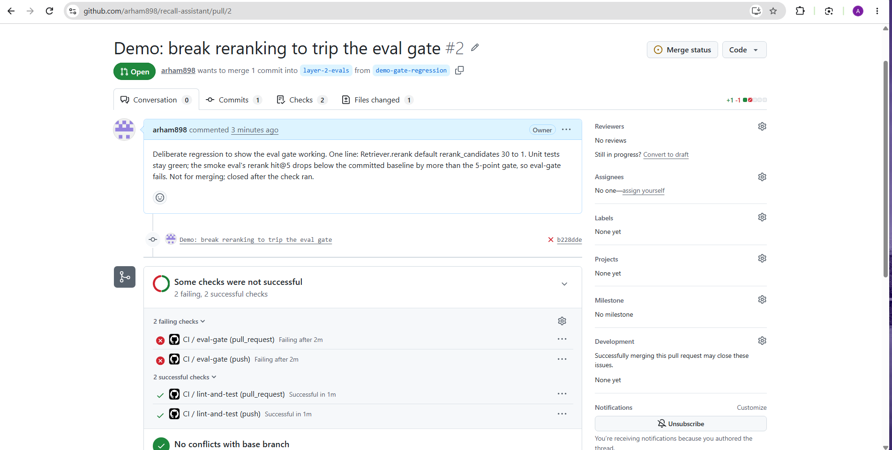

# recall-assistant

A personal learning project that builds a question-answering service over public NHTSA vehicle recall data. The system is constructed in layers — starting with data ingestion and retrieval, progressing through evaluation, API deployment, and agent tooling — to explore the full stack of a RAG application on real-world public data.

## Data source and licence

This project uses vehicle recall data published by the [National Highway Traffic Safety Administration (NHTSA)](https://www.nhtsa.gov/recalls). NHTSA data is produced by a US federal agency and is in the **public domain** (not subject to copyright under 17 U.S.C. § 105).

## How it works

A question comes in through the CLI. The system retrieves the top matching recall chunks from Postgres using one of four modes: dense (pgvector cosine), keyword (tsvector), hybrid (reciprocal rank fusion of dense + keyword), or rerank (hybrid followed by a cross-encoder). The retrieved chunks are numbered and sent to an LLM (via OpenRouter) with instructions to answer only from those sources and cite campaign IDs in square brackets. The response is parsed for citations, each citation is checked against the retrieved set, and the answer is classified as answered (valid citations), declined (the model replied with the exact decline marker), or invalid (missing citations, IDs not in the retrieved sources, or malformed output).

## Architecture

```
Question
  |
  v
Retriever (dense / keyword / hybrid / rerank)
  |  Postgres: pgvector HNSW + tsvector GIN
  |  Embeddings: BAAI/bge-small-en-v1.5 (384-dim)
  |  Reranking: cross-encoder/ms-marco-MiniLM-L-6-v2
  v
Prompt builder (numbered sources with campaign IDs)
  |
  v
LLM (OpenRouter, e.g. gemini-2.5-flash-lite)
  |  Custom retry: 429/5xx with backoff, 402 fail-fast
  v
Citation parser + status classifier
  |  answered / declined / invalid
  v
CLI output (answer, citations, cost, latency)
```

Data flows from NHTSA flat files through a parser, filter, chunker (record or field level), and embedder into Postgres. The `recalls`, `recall_vehicles`, and `chunks` tables hold the structured data, text chunks, and 384-dim embeddings. Partial HNSW indexes on the `chunks` table (one per chunker type) are confirmed in use by EXPLAIN on the real data (`uv run python scripts/explain_check.py`).

## Layers

- [x] Layer 1: Ingestion, hybrid retrieval, LLM answers with citations, CLI
- [x] Layer 2: Evals (golden question set, retrieval and answer-quality metrics)
- [ ] Layer 3: API and deployment (FastAPI service, Docker Compose, CI)
- [ ] Layer 4: Tracing (OpenTelemetry spans, cost and latency tracking)
- [ ] Layer 5: Agent (tool-using agent with retrieval and SQL tools)
- [ ] Layer 6: MCP server (expose retrieval as an MCP tool)
- [ ] Layer 7: Claude SDK (swap LLM backend to Anthropic SDK)

## How to run

```bash
# Install dependencies
uv sync

# Start Postgres (once Docker is running)
docker compose up -d db

# Download NHTSA data, load, chunk, and embed
uv run python scripts/download_data.py
uv run python scripts/load_recalls.py
uv run python scripts/embed.py --chunker record
uv run python scripts/embed.py --chunker field

# Run fast tests (no database needed)
uv run pytest -m "not integration"

# Run all tests
uv run pytest

# Lint and format check
uv run ruff check . && uv run ruff format --check .

# Search recalls
uv run python -m recall_assistant.cli search "brake hose leak" --mode hybrid

# Ask a question (requires OPENROUTER_API_KEY and LLM_MODEL in .env)
uv run python -m recall_assistant.cli ask "seat belt problems" --make FORD --model-name RANGER --year 2021
```

## Results

| Metric | Value | Command |
|--------|-------|---------|
| Campaigns loaded | 7,514 | `uv run python scripts/load_recalls.py` |
| Record chunks | 7,537 | `uv run python scripts/measure_tokens.py` |
| Field chunks | 22,545 | `uv run python scripts/measure_tokens.py` |
| Record chunk median tokens | 185 | `uv run python scripts/measure_tokens.py` |
| Tests | 148 passing | `uv run pytest` |

Full metrics in [docs/results.md](docs/results.md).

### Layer 2: evals

The golden set has 150 questions: 100 generated from five templates, 30 handwritten, and 20 unanswerable. All 150 are scored by automated code checks; 100 were hand-labelled for judge calibration.

**Retrieval** (record chunker, unfiltered, n=130; "Retrieval evaluation: cards_all_components (Module 2.2)" in [docs/results.md](docs/results.md)):

| Mode | hit@5 | MRR |
|------|-------|-----|
| dense | 0.900 | 0.756 |
| keyword | 0.700 | 0.537 |
| hybrid | 0.931 | 0.756 |
| rerank | 0.985 | 0.888 |

```
Command: python scripts/eval_retrieval.py --label cards_all_components
```

**Answers** (hybrid_record_unfiltered, 130 answerable questions; "Answer evaluation: hybrid_record_unfiltered_v3 (Module 2.3)" in [docs/results.md](docs/results.md)): the 19 Oct baseline passed 85/130; after prompt fixes (v3) that rose to 91/130. v3 had 8 uncited and 11 bad_citation. HHEM faithfulness median for v3: 0.961.

```
Command: python scripts/score_answers.py --answers results/answers_hybrid_record_unfiltered_v3_2026-10-23.jsonl
```

**Judge calibration** ("Judge calibration (Module 2.4)" in [docs/results.md](docs/results.md)): 100 hand labels. The v2 LLM judge reached test kappa 0.758 and test agreement 0.900. The deterministic code checks agree with the hand labels 0.900 of the time.

```
Command: python scripts/calibrate_judge.py --labels evals\labels.jsonl --answers results\answers_hybrid_record_unfiltered_2026-10-19.jsonl --prompt-version v2
```

**Failure analysis** ("Failure analysis (Module 2.5)" in [docs/results.md](docs/results.md)): 57 failure rows. The two largest categories: "wrong year or vehicle admitted" (22) and "format leak" (21).

```
Command: python scripts/tally_failures.py --worksheet docs/error-analysis.md
```

The CI eval gate is described in the subsection below. Full per-template breakdowns, faithfulness distributions, and prompt-fix comparisons are in [docs/results.md](docs/results.md); design rationale is in [docs/decisions.md](docs/decisions.md).

### CI eval gate

The `eval-gate` job in CI loads a 692-campaign sample into a scratch
Postgres database, embeds it, and runs 25 smoke questions through four
retrieval modes, filtered and unfiltered, eight configurations. It compares
hit@5 against a stored baseline and fails the run if either gated
configuration (hybrid or rerank, unfiltered) drops by more than 5 points.
A deliberate regression PR (#2) showed the check failing on a one-line
change while the unit tests stayed green. `eval-gate` is a required check
on `main`.



## Limitations

- This is a learning project, not a production system.
- Only covers NHTSA recall data; does not include other vehicle safety datasets.
- LLM answers are not guaranteed to be accurate — always verify against the source data.
- No authentication or access control is implemented.
